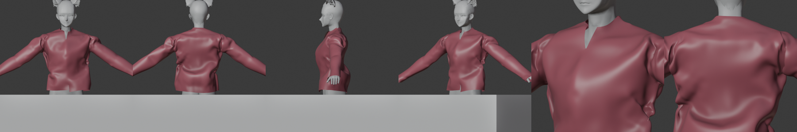
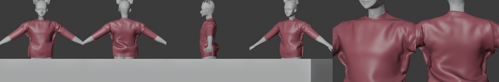
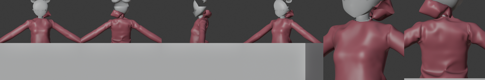
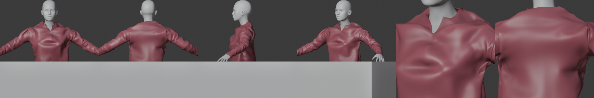

# Fase 2: proporciones anime, reporte

Fecha: 2026-11-19, cerrada el 2026-11-20 · Rama `fase-2` (sale de `fase-1`) · Blender 5.2.4 (pruebas automáticas) y 5.2.0 (PC de Allan)

**Estado: cerrada por Allan el 2026-11-20.** La capucha pasa a la Fase 4.

## Resumen

1. **Mangas en T-pose (lo más importante).** Los avatares de VRChat descansan
   en T-pose y las mangas se salían del brazo al coser. Ahora el add-on cose
   con los brazos bajados y Finalize devuelve la prenda a la T-pose: las
   mangas envuelven el brazo y lo siguen.
2. **Manos grandes y muñecas finas.** El puño de las mangas largas no pasaba
   por la mano de Mao y la manga salía disparada. Ahora el puño se patrona
   contra la palma.
3. **Cabeza grande para el cuello.** La capucha salía del contorno del
   cuello y en Mao medía 0,72 veces su cabeza. Ahora sale de la cabeza.
4. **Figura.** No había que arreglar nada: Hanka, Minase y Vlau son
   masculinos y Mao femenina, y el add-on acertaba. El "Hanka sale como
   hombre" de la Fase 1 era un error mío (ya corregido en
   `docs/fase1_reporte.md`).
5. **Pecho, cintura, cadera y cuello.** Revisados dibujando las secciones
   sobre los seis cuerpos: caen en su sitio. Cinturas finas y piernas largas
   ya se resuelven porque todo se mide sobre la malla y los huesos (bajos,
   cinturilla y largo de pantalón pasan en los cuatro avatares).
6. **Tests nuevos:** `tests/test_anime_bodies.py`.
7. **Costuras (secciones 6 y 7).** Mangas cosidas al hombro sin piel a la
   vista, manga colocada en su sitio (fallo de upstream), Jacket con el
   delantero sin cruzar y V limpia, espalda sin pliegue. Probado en el
   Blender de Allan con Hanka + Jacket.
8. **Sin resolver:** la capucha (sección "Pendiente"); va a la Fase 4.

Nora y Theo (los cuerpos de upstream) miden y patronan exactamente igual que
antes: ninguna de las reglas nuevas se activa con ellos.

## 1. Pose de ajuste para avatares en T-pose (`clothing_design/fitpose.py`)

**Qué pasaba.** El cuerpo de la camiseta tiene la sisa en el costado del
torso, que es donde queda con los brazos bajados. En T-pose la copa de la
manga rodea un brazo horizontal, y las costuras la arrastraban hacia esa sisa
y la sacaban del brazo. Se ve en las capturas de fases: colocada, bien; a
mitad del cosido, ya arrugada hacia el torso.

**Qué hace ahora.**
- Set Avatar: si los brazos están a más de 70° de la vertical, los baja a 60°
  (la pose con la que upstream prueba Nora y Theo). Es solo una pose: el
  rest pose del rig no se toca. Se mide, se patrona y se cose así.
- Finalize: después de atar los pesos calcula, para cada vértice, la inversa
  de la mezcla de matrices de sus huesos (el skinning inverso) y guarda la
  malla en la pose de reposo. Con el rig en la pose de ajuste se ve igual que
  al coser, y cuando el rig vuelve a la T-pose las mangas suben con el brazo.
- El botón **Rest Pose** (o **T-Pose** en el panel Avatar) devuelve los
  brazos a su sitio.
- Opción en el panel Avatar: **Lower Arms to Sew** (activada) y el ángulo.

**Resultado** (`tests/test_booth_avatars.py --drape`, T-Shirt finalizada y el
rig de vuelta en T-pose):

| | Hanka | Mao | Minase | Vlau |
|---|---|---|---|---|
| Manga respecto al eje del brazo | 54 mm | 38 mm | 49 mm | 64 mm |
| Manga al bajar el brazo (mediana) | 115 mm | 90 mm | 111 mm | 105 mm |
| Torso al bajar el brazo | 0 mm | 0 mm | 0 mm | 0 mm |

Entre 38 y 64 mm del eje significa que la manga rodea el brazo. En la Fase 1
la manga colgaba debajo.

## 2. Puño de manga larga contra la palma

La manga larga se cortaba pasada la muñeca (1,08 × el brazo; ahora 1,0, ver sección 7) y termina sobre la
mano. Su puño salía del ancho del bíceps × 0,82. En Nora eso da un puño de
1,35 veces su palma; en Mao, de 0,92: no le pasa la mano, la colisión lo
expulsa y la manga sale disparada al empezar a coser.

- `avatar.palm_girth()`: contorno real de la palma, sin dedos, 2–6 cm pasada
  la muñeca (como polígono, porque la palma es plana). Nora 19,6 cm, Theo
  25,5, Hanka 24,2, Mao 19,3, Minase 28,3, Vlau 23,6.
- El puño de una manga que llega a la mano mide al menos 1,3 veces la palma,
  el margen que ya tiene Nora.
- ~~Como el puño ensanchado deja la manga más holgada en el antebrazo y se
  arruga más al coser, esa manga se corta un 16% más larga.~~ Retirado en la
  sección 7: ese largo extra solo compensaba la copa aplastada.

Probé también estrechar la manga hasta la muñeca y ensancharla solo sobre la
mano: fue peor (la manga de Mao llegaba al 26% del brazo) y lo descarté.

## 3. Capucha a la medida de la cabeza

Las cabezas de estos avatares no son grandes respecto a la altura (10–13%,
como Nora); lo anime es la cabeza respecto al cuello. La capucha salía del
cuello (alto = cuello × 0,62).

- `avatar.head_size()`: largo, fondo y ancho de la cabeza, incluida la malla
  de la cara si va aparte.
- La capucha llega al menos a lo que tiene Nora: 0,96 veces el fondo de la
  cabeza y ~1,05 veces su largo. El borde que se cose al escote no cambia;
  para el fondo se agranda solo la parte trasera de la coronilla.

| Capucha / cabeza | antes | ahora |
|---|---|---|
| Mao (fondo / largo) | 0,76 / 0,72 | 0,96 / 1,04 |
| Hanka | 0,83 / 0,87 | 0,96 / 1,05 |
| Minase, Vlau, Nora, Theo | ya por encima | sin cambio |

## 4. Revisión de las medidas

| | Altura | Pecho | Cintura | Cadera | Cuello | Figura |
|---|---|---|---|---|---|---|
| Nora (upstream) | 160,6 | 87,5 | 67,2 | 91,5 | 32,9 | mujer |
| Theo (upstream) | 185,8 | 102,1 | 79,9 | 93,6 | 38,5 | hombre |
| Hanka | 172,5 | 85,3 | 61,8 | 77,2 | 25,9 | hombre |
| Mao | 147,6 | 60,4 | 51,2 | 77,7 | 19,3 | mujer |
| Minase | 166,8 | 82,4 | 57,5 | 75,9 | 29,6 | hombre |
| Vlau | 185,4 | 112,0 | 82,7 | 96,5 | 40,8 | hombre |

Dibujé los anillos de cada medida sobre los seis cuerpos, de frente y de lado.
Caen en su sitio: el cuello en su base, el pecho bajo las axilas en los
hombres y en el busto en Mao y Nora, la cintura en lo más estrecho, y bien la
cadera, la entrepierna y la rodilla. En los avatares anime el pecho queda más
cerca del hombro (4–8 cm) que en Theo (11 cm), por el torso en V.

Los cuellos finos (Mao 19,3 cm) son reales: el escote se patrona a esa medida
y, en el simulador, la cabeza no tiene que pasar por él.

## 5. Tests

- **`tests/test_anime_bodies.py` (nuevo).** Al estilo de `test_bodies.py`
  (puntos de medida en orden y separaciones sensatas) y de `test_fit.py`
  (cose las 8 prendas y comprueba bajo, cinturilla y manga respecto al propio
  cuerpo), más las reglas nuevas: puño/palma, capucha/cabeza, pose de ajuste.
  Con `--quick` solo mide y patrona.
- **`tests/test_booth_avatars.py`:** ahora comprueba también que en T-pose la
  manga queda alrededor del brazo.

**Resultados finales** (con el código de este commit):

- `test_anime_bodies.py`: **152 comprobaciones, 0 fallos**. Las 8 prendas
  en los 4 avatares con el bajo, la cinturilla y la manga en su sitio. Mangas
  largas: Hanka 1,05 / 1,06, Mao 0,92 / 0,85, Minase 1,00 / 1,02, Vlau
  0,96 / 0,97 del brazo (Jacket / sudadera; rango válido 0,80–1,18).
- `test_booth_avatars.py --drape`: **76 comprobaciones, 0 fallos** (4 avatares, T-Shirt y Jacket, Finalize, brazo, T-pose).
- `test_presets.py` (upstream): 0 fallos; Nora y Theo con las mismas medidas.
- `test_rig_names.py`: 145/145.

## 6. Mangas cosidas al cuerpo (corrección tras revisar las capturas)

En el primer reporte dije que la piel visible entre manga y cuerpo en el
hombro era "aspecto de upstream". **Era falso**: eran fallos de cosido.
Dos causas, comprobadas midiendo los bordes abiertos y la piel expuesta:

1. **Agujeros en las esquinas.** Donde se juntan 3 piezas (manga, delantero y
   espalda) la soldadura dejaba huecos pequeños. `sim.close_corner_holes`
   cierra los lazos de borde pequeños (≤6 vértices, ≤12 cm) y rellena los que
   tocan 3 piezas o más (≤12 vértices, ≤35 cm). Las aberturas de verdad
   (cuello, puños, bajo, cara de la capucha) no se tocan.
2. **Fuerza de costura ilimitada.** Con `sewing_force_max = 0` la costura
   tiraba de la tela a través del hombro antes de cerrarse. Ahora: fuerza 15,
   80 fotogramas, y hasta 40 más si queda alguna puntada abierta
   (`max_stitch_gap`). Si aun así no cierra, se repite el cosido con fuerza
   ilimitada (respaldo).

| Prenda | Piel expuesta antes | Después | Puntadas abiertas |
|---|---|---|---|
| Hanka T-Shirt | 8 % | 0 % | 0 |
| Hanka Jacket | 24 % | 3–4 % | 0 |
| Nora T-Shirt | 20 % | 4 % | 0 |
| Nora Jacket | 17 % | 2 % | 0 |

**Probado en el Blender 5.2.0 de Allan** (Hanka + Jacket): los hombros y la
espalda quedan cerrados, sin piel entre manga y cuerpo.

Tests después del cambio: `test_presets.py` 0 fallos; `test_fit.py` 0 fallos
(58 ok); `test_booth_avatars.py --drape` en Hanka y Mao, 30 ok y 0 fallos
hasta donde llegó en 10 min (falta la Jacket de Mao); `test_anime_bodies.py
--quick` 36 ok en los 4 avatares; la versión con cosido en Hanka, 26 ok y 0
fallos antes de cortarse por tiempo. Las tandas completas quedan por correr.

## 7. Segunda ronda de costuras: manga, delantero y pines

Allan seguía viendo costuras mal en su Blender: la sudadera de Mao con las
mangas amontonadas y el brazo al aire, y la Jacket de Hanka corta, con una
solapa cruzada y un pliegue en la espalda. Midiendo qué puntadas quedaban
abiertas fotograma a fotograma salieron cuatro causas, tres de ellas en el
código de upstream:

1. **La manga se colocaba metida en el hombro** (`library._sleeve_height`).
   `patterns.py` centra cada pieza en su caja, pero la altura de la manga
   (0,22 fija) se calculó como si el origen fuera la línea de la axila. La
   axila caía un 30% del brazo *dentro* del hombro y la copa se aplastaba
   contra el tope de −0,25 de `build.limb_f`. En Mao, con el brazo corto, la
   esquina de la axila de la manga empezaba en el centro del pecho y la
   costura de la axila nunca cerraba (quedaban 10 cm). Ahora se calcula el
   centro para que la axila caiga a 0,10 del brazo, y el tope pasa a
   −0,6/+1,6. Al no comerse la copa el largo, los factores de largo de la
   manga (1,08 de upstream y 1,16 de la Fase 2) sobraban: ahora 1,0.
2. **Las dos mitades del delantero de la Jacket empezaban cruzadas.** El
   mismo centrado: en la versión cerrada no se giraban, y el borde central de
   la mitad izquierda arrancaba en el lado derecho del cuerpo. Al coser se
   atravesaban: ese era el pliegue diagonal ("solapa"). Ahora se giran como
   en la versión abierta.
3. **Solapa suelta de 20 cm.** Upstream solo cosía un "botón" de 9 cm y dejaba
   suelto el borde desde el cuello hasta la cintura. Ahora: V de 8 cm, cerrada
   hasta 5 cm del bajo.
4. **Los pines del cuello doblaban la espalda.** Sujetan toda la tela por
   encima del hombro, también los bordes de la costura del hombro, que no
   puede cerrar hasta que se sueltan (fotograma 48). Entonces cierra de
   golpe con la espalda aún sujeta y la espalda se dobla bajo el cuello (el
   "agujero" de la camiseta de Hanka); la prenda queda además subida. Los
   pines se pusieron para una chaqueta sobre otra prenda: ahora solo se usan
   si hay otra prenda debajo.

Además, el respaldo (volver a coser todo a fuerza ilimitada) entraba por una
sola puntada abierta y era lo que estropeaba la prenda; ahora solo entra si
quedan más de 3.

| Prenda | Antes | Ahora |
|---|---|---|
| Mao sudadera | axila sin cerrar, respaldo, mangas amontonadas | todo cerrado sin respaldo, manga 1,05–1,07 del brazo |
| Hanka Jacket | respaldo, solapa cruzada, pliegue en la espalda, corta | sin respaldo, V limpia, llega a la cadera |
| Hanka camiseta | espalda doblada bajo el cuello | lisa |
| Nora Jacket | bien | bien, cerrada con V |

Tests con todo esto: `test_fit.py` 0 fallos (58 ok, mujer y hombre);
`test_presets.py` 0 fallos; `test_booth_avatars.py --drape` 64 ok y 0 fallos
en los 4 avatares; `test_anime_bodies.py` completo 152 ok y 0 fallos (mangas
largas entre 1,04 y 1,12 del brazo); `test_rig_names.py` 145/145.

## Pendiente

- **Sudadera de Vlau, resultados que varían:** en una corrida su manga
  izquierda llegó solo al 0,61 del brazo, arrugada en el codo; en la
  siguiente, con el mismo patrón, al 0,97. La simulación de Blender no da
  siempre lo mismo y esta prenda está cerca del límite. La manga izquierda
  retorcida también aparece en Nora con la camiseta de upstream. No lo aislé.
- **Capucha de la sudadera (investigada, sin resolver):** su costura cierra,
  pero la forma final no sale bien en los tres cuerpos a la vez. Upstream
  coloca la capucha de pie junto a la cabeza, pero el mapeado del torso por
  encima del hombro usa la sección del hombro: las piezas arrancan en la
  punta de los hombros y caen 20–30 cm (cono tieso en Nora, rollo en el
  cuello de Hanka, caída a un lado en Mao). Probé cinco colocaciones (tendida
  en la espalda, puesta en la cabeza con un anclaje nuevo a la sección del
  cuello, girada 0,45/0,9 hacia atrás, y con el borde del cuello sobre el
  escote): cada una mejora uno o dos cuerpos y empeora otro. Dos causas que
  se repiten: tendida, el borde recto del cuello no puede rodear el cuello y
  tira del escote hacia atrás; de pie, las puntas delanteras tienen que viajar
  hasta el centro del escote y en un cuello fino (Mao, 19 cm) se meten dentro
  del cuello. Lo dejé como upstream. `cd.sew` ahora imprime cuántas puntadas
  quedan abiertas, para diagnosticarlo.
- **Capucha puesta (elegida por Allan), intentada y revertida:** anclaje
  nuevo a la sección del cuello y la cabeza, capucha cortada del escote a la
  coronilla y pines que la sujetan contra la cabeza mientras se cose (dejando
  libre la costura de la coronilla). Lo mejor que salió: la capucha queda en
  la cabeza enmarcando la cara (Hanka), pero sin cerrar por arriba. Causa: la
  colocación envuelve cada pieza en un cilindro vertical; los bordes de la
  coronilla empiezan a los lados de la cabeza y la costura tendría que tirar
  a través de ella. Sin pines la capucha se cae detrás. Con el perfil del
  torso (que deja la cabeza fuera a propósito) queda dentro de la cabeza.
  Encontrado de paso: la cabeza de Mao es una malla aparte que no colisiona
  con la tela. Para hacerlo bien hace falta colocar la capucha sobre una
  forma de cúpula alrededor de la cabeza, no un cilindro.
- **Arrugas:** las mangas largas siguen con pliegues, sobre todo en Nora.
- **Cuello alto** en camiseta y sudadera: es el patrón original (Fase 4).
- **Cintura entallada:** upstream limita el entallado del costado a 2,2 cm
  para no pellizcar la tela. En cinturas anime muy finas las prendas quedan
  rectas; entallarlas de verdad necesita pinzas (Fase 4).
