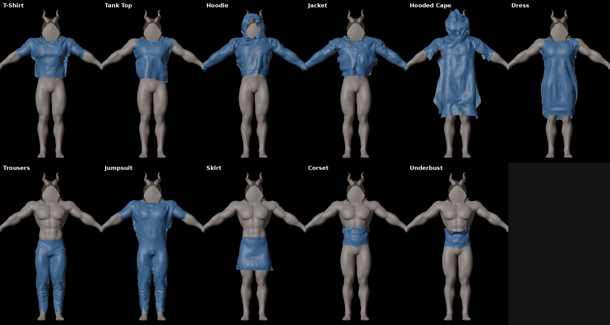

# Prueba con The Beast (EZAvatars)

Avatar de Allan: `E:\assets\DOWNLOADS\The Beast 1.0`. Viene solo como `.unitypackage` (837 MB). El FBX (`Assets/Avatars/BigMuscleTool/TheBeast.fbx`) se sacó del paquete con un script en la consola de Python de Blender (`extract_unitypackage_fbx.py`, en `OpenSew_test`).

El avatar se sale de todo lo probado hasta ahora:
- mide 2,36 m con los cuernos;
- es muy musculoso: pecho de 163 cm, muslos que casi se tocan (1–2 cm entre ellos);
- su esqueleto usa nombres al estilo CATS: `Left arm`, `Left elbow`, `Left wrist`, `Left leg`, `Left knee`, `Left ankle`, más huesos auxiliares (`Left elbowHelper`, `Left KneeHelper`, `Left Butt`, `Peck_Parent`, `Cape_*`).

Su ropa (`Outfit`) se quitó antes de vestirlo, como haría un usuario.

## Fallos encontrados y arreglados

1. **No encontraba ninguna extremidad (0 de 8).**
   - Causa: el reconocedor de huesos no conocía `elbow` (antebrazo) ni `knee` (espinilla), y solo entendía `Leg` al estilo Mixamo, donde es la espinilla. En CATS `Left leg` es el muslo.
   - Arreglo, en `rig.py`:
     - `elbow` y `knee` son alias **débiles**: solo cuentan si no hay un antebrazo o una espinilla con nombre claro, y si de ese hueso cuelga la mano o el pie. Así un hueso corrector `Left_Knee` junto a la espinilla de verdad (Vlau), o un `Knee.L` de física colgando de la cadera, no les quita el puesto. En la primera versión eran alias normales y el advisor lo vio.
     - `Leg` es el muslo cuando de él cuelga la espinilla, mirando más allá de los huesos de twist (`Left arm > Left arm twist > Left elbow`, MMD sin Fix Model).
   - Resultado: 8 de 8, y baja los brazos de 90° a 60° para coser.
   - `test_rig_names` añade el rig CATS, el corrector de Vlau listado primero, el `Knee.L` de la cadera, Mixamo con un `LeftKnee` auxiliar, el twist entre brazo y codo y las etiquetas de los dedos: 159 comprobaciones, 0 fallos.
2. **Pantalón con la entrepierna y los costados abiertos** (17 costuras abiertas aun cosiendo a fuerza completa).
   - Causa: el muslo se medía con 32 cm de radio en vez de 13. El grupo de vértices `Left leg`, leído solo por su nombre, no se reconocía como muslo, y la medición acababa usando todos los puntos de esa franja del cuerpo, cadera incluida. Cada pernera salía de 1,1 m de ancho.
   - Arreglo, en `rig.bone_labels` y `avatar.group_labels`: los grupos de vértices se etiquetan por el papel de su hueso en el esqueleto, que ya está resuelto con todo el árbol a la vista.
   - Resultado: muslo de 13–14,5 cm de radio, y el pantalón se cose sin ninguna costura abierta.
   - Las medidas de los otros 7 avatares (Manuka, Hanka, Mao, Vlau, Minase y los dos integrados) salen idénticas a las de la 1.3.1, comparadas campo a campo con el script del advisor. En la primera versión no lo eran: los dedos salían como `finger_index.l` y la palma de Manuka bajaba un 3 %, y con `knee` fuerte cambiaban las piernas de Vlau.
   - La caché de medidas guardada en el `.blend` lleva ahora la versión del código de medir (`MEASURE_VERSION`): un archivo de la 1.3.1 vuelve a medir a The Beast en vez de quedarse con 0 de 8.
3. **Camiseta de tirantes y vestido escurriéndose por los hombros.**
   - Causa: el escote llegaba al 88 % del ancho de hombros, con los tirantes en la punta del hombro. En los demás avatares es del 17 al 46 %. Se juntan dos cosas: su cuello se lee como 82 cm porque el escaneo para en los trapecios (más arriba seguía bajando a 75), y las profundidades del escote son fijas en cm, así que un perímetro grande solo puede crecer a lo ancho.
   - Arreglo, en `library._draft_top`: en las prendas sin manga, el escote no pasa del 55 % del ancho de hombros (`NECK_MAX_SHARE`), pero nunca queda a menos de 1,5 cm del costado del cuello real (`neck_side_radius`). Solo afecta a cuerpos como el suyo.
   - Resultado: tirantes y vestido se quedan en los hombros.
   - Primero se aplicó también a las prendas con manga, y la camiseta empeoró: la costura del hombro se alargaba y las mangas se separaban del cuerpo. Por eso se limitó a las prendas sin manga.

Dos hipótesis que se probaron y se descartaron:
- **Abrir las piernas 8° para coser** (como se bajan los brazos): el pantalón salía peor, con 22 costuras abiertas.
- **La entrepierna medida en el hueso y no en la malla**: la diferencia es del 2–5 % en todos los avatares, también en los integrados, donde el pantalón sale bien.

4. **Resolución por tamaño del avatar** (aprobado por Allan y revisado antes por el advisor).
   - `avatar.size_factor`: 1 hasta 1,50 m de altura de hombro y proporcional por encima. Nunca afina la malla. Todos los avatares probados hasta ahora dan 1, también el hombre integrado (1,49 m); The Beast da 1,22.
   - Se mide en el hombro y no en la estatura, que cuenta cuernos, orejas y sombreros.
   - Se guarda en cada pieza y en la prenda (`cd.res_scale`), sin tocar el ajuste Resolution del usuario. El panel avanzado muestra la que usa la prenda.
   - Escalan con él lo que depende de la arista:
     - Max Stitch Gap (`sim.stitch_dist`);
     - los perímetros de los agujeros que se cierran al soldar;
     - el ancho mínimo de pliegue (`PLEAT_MIN_FACE`);
     - la distancia de piezas vecinas en Auto Seams;
     - Draw Pattern, que usa la resolución de la prenda en la que dibuja.
   - Física: la masa de la tela va por vértice y se multiplica por el factor al cuadrado para no aligerar la tela. La fuerza máxima de costura va por muelle y se multiplica por el factor. Sin esto la sudadera quedaba con 3 puntadas abiertas; con ello, 0.
   - Resultado en The Beast: sudadera de 11.181 triángulos, que pasa toda la prueba de exportación y cierra todas sus costuras; falda de pliegues limpia en 2 minutos. En Hanka la sudadera no cambia.

## Resultado por prenda

`test_fit` (que ahora acepta un FBX: `-- --fbx ruta --drop Outfit`) pasa en las 8 prendas que mide: camiseta, tirantes, falda, pantalón, mono, vestido, chaqueta y sudadera. Mira bajos, mangas, suelo y penetración en el cuerpo.

- **Bien:** camiseta, sudadera (manga a 1,08 del brazo, dentro del margen 0,80–1,18), chaqueta, pantalón, mono (el mejor), falda, capa, y ahora tirantes y vestido.
- **Límites que quedan:**
  - El corsé y el underbust resbalan hasta la cintura. En un torso en V no hay repisa de pecho que sostenga una tela rígida.
  - La capucha es estrecha para sus cuernos y estos la atraviesan.
  - En camiseta, sudadera y chaqueta asoman pestañas pequeñas en la costura lateral, a la altura del bajo.
  - Chaqueta, tirantes y vestido necesitan la segunda pasada a fuerza completa (las costuras se cierran, pero tarda más).
- **Exportación** (`test_export`, sudadera): todo correcto (huesos con sufijo, pesos, máscara, la capucha sigue a la cabeza, el brazo mueve la manga). Con aristas fijas de 1,8 cm pesaba **16.577 triángulos**, por encima del límite de 12.000. Su hombro está a 1,83 m y su pecho mide 163 cm, mucha más tela que en un avatar normal. Eso llevó al punto 4.

## Los demás avatares con el código final

`test_fit` con las 8 prendas que mide (camiseta, tirantes, falda, pantalón, mono, vestido, chaqueta y sudadera) y `test_export` con la sudadera. Vlau, Minase y las dos pruebas que faltaban se corrieron en el PC de Allan: 6 Blender a la vez en sus 12 núcleos, con el código de la rama en `OpenSew_test\run\scripts` (sin tocar el add-on instalado). Fueron unos 6 minutos, frente a más de una hora aquí.

| Avatar | test_fit | test_export (sudadera) |
|---|---|---|
| The Beast | 8 de 8 | sin fallos, 11.181 triángulos |
| Mao | 8 de 8 | sin fallos, 3.453 triángulos |
| Vlau | 8 de 8 | sin fallos, 8.738 triángulos |
| Minase | 8 de 8 | sin fallos, 6.504 triángulos |

Notas de costura (no son fallos de la prueba):
- Al mono de Minase le quedan 2 puntadas abiertas.
- Sudadera de Minase, vestido y mono de Vlau: necesitan la segunda pasada a fuerza completa.

Sus medidas son idénticas a las de la 1.3.1 y su factor de tamaño es 1, así que cosen con el mismo código que antes.
