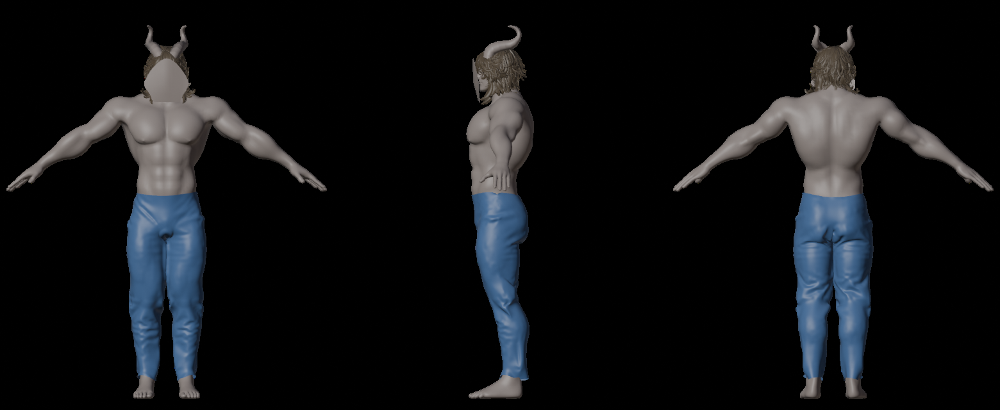

# Prueba con The Beast (EZAvatars)

Avatar de Allan: `E:\assets\DOWNLOADS\The Beast 1.0`. Viene solo como `.unitypackage` (837 MB). El FBX (`Assets/Avatars/BigMuscleTool/TheBeast.fbx`) se sacó del paquete con un script en la consola de Python de Blender (`extract_unitypackage_fbx.py`, en `OpenSew_test`).

El avatar se sale de todo lo probado hasta ahora:
- mide 2,36 m con los cuernos;
- es muy musculoso: pecho de 163 cm, muslos que casi se tocan (1–2 cm entre ellos);
- su esqueleto usa nombres al estilo CATS: `Left arm`, `Left elbow`, `Left wrist`, `Left leg`, `Left knee`, `Left ankle`, más huesos auxiliares (`Left elbowHelper`, `Left KneeHelper`, `Left Butt`, `Peck_Parent`, `Cape_*`).

Su ropa (`Outfit`) se quitó antes de vestirlo, como haría un usuario.

## Fallos encontrados y arreglados

1. **No encontraba ninguna extremidad (0 de 8).**
   - Causa: el reconocedor de huesos no conocía `elbow` (antebrazo) ni `knee` (espinilla), y solo entendía `Leg` al estilo Mixamo, donde es la espinilla. En CATS `Left leg` es el muslo.
   - Arreglo, en `rig.py`: `elbow` y `knee` son ahora alias del antebrazo y la espinilla, y `Leg` es el muslo cuando de él cuelga la espinilla.
   - Resultado: 8 de 8, y baja los brazos de 90° a 60° para coser.
   - `test_rig_names` tiene una prueba nueva con nombres CATS: 153 comprobaciones, 0 fallos.
2. **Pantalón con la entrepierna y los costados abiertos** (17 costuras abiertas aun cosiendo a fuerza completa).
   - Causa: el muslo se medía con 32 cm de radio en vez de 13. El grupo de vértices `Left leg`, leído solo por su nombre, no se reconocía como muslo, y la medición acababa usando todos los puntos de esa franja del cuerpo, cadera incluida. Cada pernera salía de 1,1 m de ancho.
   - Arreglo, en `rig.bone_labels` y `avatar.group_labels`: los grupos de vértices se etiquetan por el papel de su hueso en el esqueleto, que ya está resuelto con todo el árbol a la vista.
   - Resultado: muslo de 13–14,5 cm de radio, y el pantalón se cose sin ninguna costura abierta.
   - Las medidas de los otros 7 avatares (Manuka, Hanka, Mao, Vlau, Minase y los dos integrados) salen idénticas.
3. **Camiseta de tirantes y vestido escurriéndose por los hombros.**
   - Causa: su cuello mide 82 cm con los trapecios, y el escote llegaba al 88 % del ancho de hombros, con los tirantes en la punta del hombro. En los demás avatares es del 17 al 46 %.
   - Arreglo, en `library._draft_top`: en las prendas sin manga, el escote no pasa del 55 % del ancho de hombros (`NECK_MAX_SHARE`). Solo afecta a cuerpos como el suyo.
   - Resultado: tirantes y vestido se quedan en los hombros.
   - Primero se aplicó también a las prendas con manga, y la camiseta empeoró: la costura del hombro se alargaba y las mangas se separaban del cuerpo. Por eso se limitó a las prendas sin manga.

Dos hipótesis que se probaron y se descartaron:
- **Abrir las piernas 8° para coser** (como se bajan los brazos): el pantalón salía peor, con 22 costuras abiertas.
- **La entrepierna medida en el hueso y no en la malla**: la diferencia es del 2–5 % en todos los avatares, también en los integrados, donde el pantalón sale bien.

## Resultado por prenda

`test_fit` (que ahora acepta un FBX: `-- --fbx ruta --drop Outfit`) pasa en las 8 prendas que mide: camiseta, tirantes, falda, pantalón, mono, vestido, chaqueta y sudadera. Mira bajos, mangas, suelo y penetración en el cuerpo.

- **Bien:** camiseta, sudadera (manga a 1,08 del brazo), chaqueta, pantalón, mono (el mejor), falda, capa, y ahora tirantes y vestido.
- **Límites que quedan:**
  - El corsé y el underbust resbalan hasta la cintura. En un torso en V no hay repisa de pecho que sostenga una tela rígida.
  - La capucha es estrecha para sus cuernos y estos la atraviesan.
  - En camiseta, sudadera y chaqueta asoman pestañas pequeñas en la costura lateral, a la altura del bajo.
  - Chaqueta, tirantes y vestido necesitan la segunda pasada a fuerza completa (las costuras se cierran, pero tarda más).
- **Exportación** (`test_export`, sudadera): todo correcto (huesos con sufijo, pesos, máscara, la capucha sigue a la cabeza, el brazo mueve la manga) salvo el peso: **16.577 triángulos**, por encima del límite de 12.000 que fijamos. La malla se hace con aristas de 1,8 cm fijas, y en un cuerpo de 2,36 m eso es el doble de tela. Queda por decidir si la resolución debe escalar con la altura del avatar.

